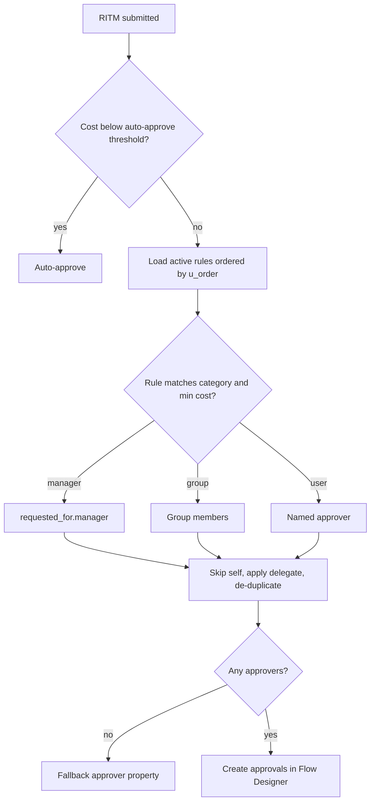

# ServiceNow Catalog Approval Engine


> **Portfolio project.** This is independently written demonstration code that uses synthetic data. It is not taken from, and does not represent, any employer's or client's production code.

ITSM automation components for Service Catalog and SLA management:

| Component | Type | What it does |
|---|---|---|
| `CatalogApprovalRouter` | Script Include | Resolves approvers from a rules table. It handles cost thresholds, manager, group, and named approvers, active delegations, de-duplication, self-approval prevention, and a fallback approver. |
| `SLAEscalationPolicy` | Script Include | Decides the escalation level from priority, % elapsed, and assignment. It notifies only when the level rises. |
| `catalogFormValidation.js` | Catalog Client Script (onSubmit) | Validates justification, cost, needed-by lead time, and asset-tag format, and shows field-level messages. |

## The business problem

When approvers are hard-coded in each catalog item's flow, every org change means editing flows. Without escalation logic, SLA breaches are found too late or flood managers with duplicate alerts. Moving routing rules into data lets process owners maintain approvals without code changes.



## Sample output (synthetic data)

```
$ npm run demo
Approval routing
  hardware  $20     -> auto-approved
  hardware  $1200   -> u_mgr
  hardware  $7500   -> u_mgr, u_fin1, u_backup      # u_fin2 delegated to u_backup
  software  $300    -> u_mgr                        # security group member already approving

SLA escalation
  P1  60% assigned   -> level 1: notify_assignee
  P1  92% assigned   -> level 3: notify_service_owner_and_major_incident_manager
  P2  55% unassigned -> level 2: notify_group_manager
  P3  80% assigned   -> level 1: notify_assignee
```

## Tech stack

ServiceNow Service Catalog, Flow Designer (Run Script step), Script Includes (ES5), Catalog Client Scripts (`g_form`), Task SLA, `sys_user_delegate`, and system properties. Tests use the Node.js 18+ built-in test runner (18 tests). GitHub Actions runs CI.

## Run locally

```bash
git clone https://github.com/pedapatisrujana-a11y/servicenow-catalog-approval-engine.git
cd servicenow-catalog-approval-engine
npm test
npm run demo
```

## Install in a ServiceNow instance (PDI recommended)

1. Create a table `u_approval_rule` with these fields: `u_name`, `u_active` (true/false), `u_order` (integer), `u_category` (string; `*` matches any category), `u_min_cost` (decimal), `u_approver_type` (choice: manager, group, user), and `u_approver` (string or reference).
2. Create the Script Includes from `src/`.
3. In the catalog item's flow, add a **Run Script** step that calls `new CatalogApprovalRouter().getApprovers(ritm)`. Then pass `approvers` to an **Ask for Approval** action.
4. Add `src/client/catalogFormValidation.js` as an onSubmit Catalog Client Script. Copy everything except the last `module.exports` line, which only exists for testing.
5. Set the system properties listed in `config.example.json`.

## Security and quality notes

- The rules table should be writable only by a catalog admin role, with ACLs on `u_approval_rule`.
- Client-side validation is for user experience only. Repeat critical checks server-side, for example in a before-insert Business Rule or a Flow step.
- No credentials or instance data are included.

## Limitations and next steps

- Multi-level manager chains (for example, two levels up for costs above $25k) are not implemented yet.
- Planned: expose the router as a custom Flow Designer action, and add an ATF test suite for in-instance regression.

## License

MIT. See [LICENSE](LICENSE).
